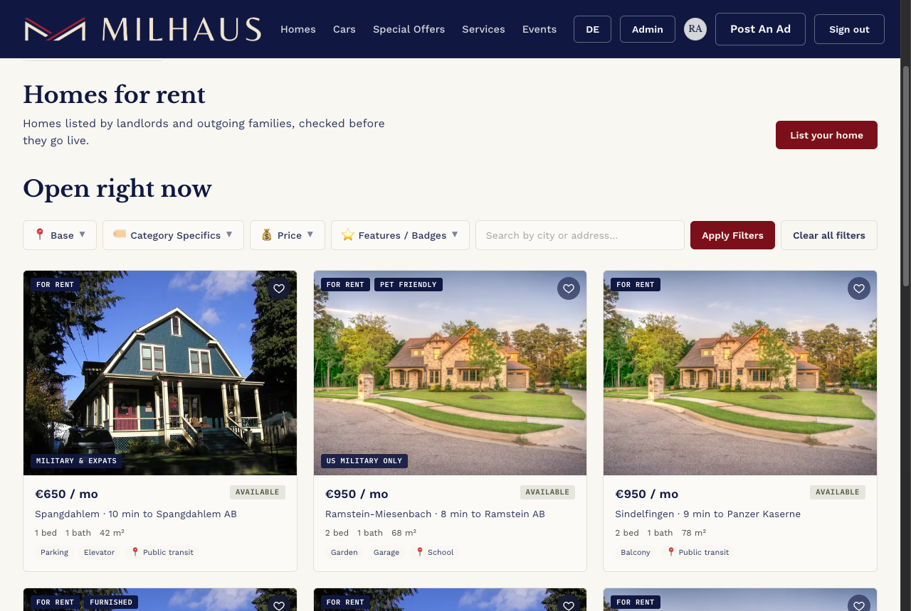
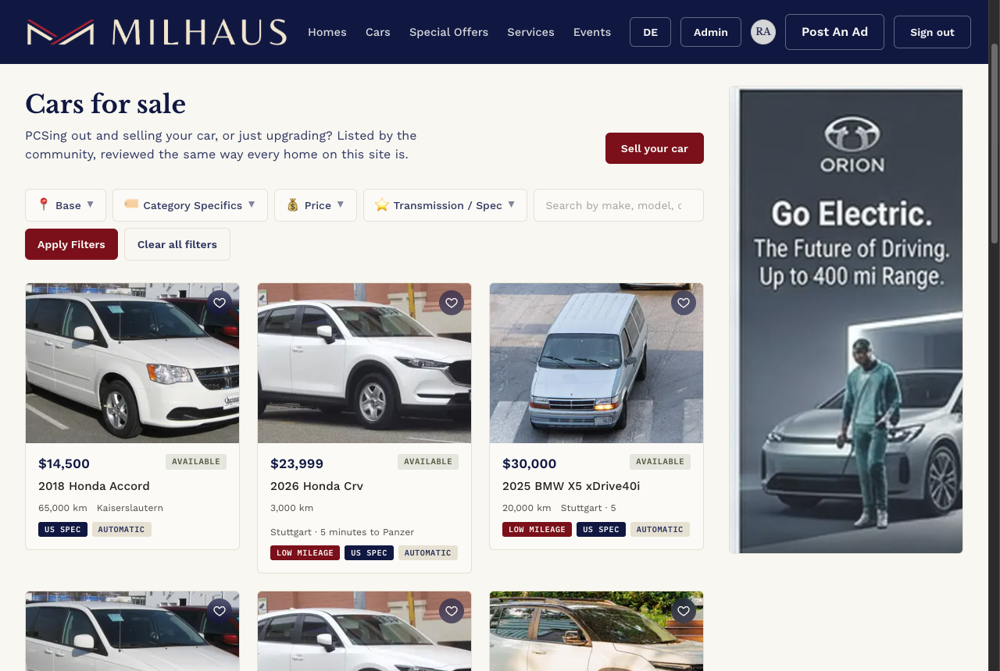
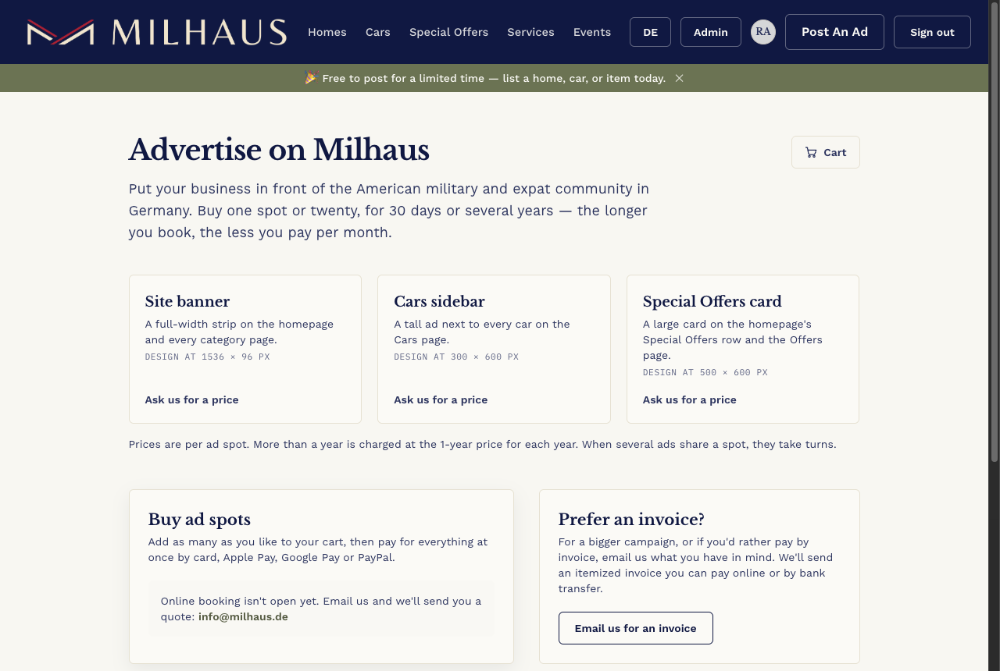
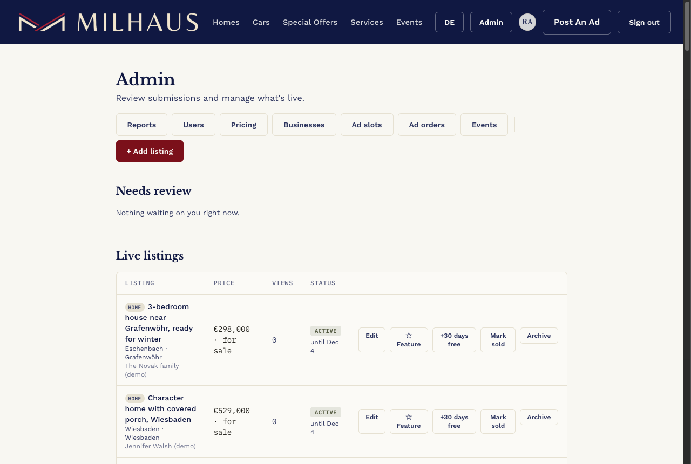

<!-- README.md -->
# Milhaus

**A bilingual marketplace for the American community in Germany — homes,
cars, local services, promotions and events in one place.**

[www.milhaus.de](https://www.milhaus.de)


## Overview

Every year thousands of American service members, civilians and their
families move to and from Germany. Housing, cars and trusted local services
are scattered across Facebook groups and classified boards. Milhaus brings
them together in one clean, trustworthy, searchable site:

- **Homes** — for rent and for sale, posted by landlords and by families
  moving out, filterable by base, price, size, features and eligibility.
- **Cars** — including U.S.-spec vehicles sold before a move.
- **Services** — a directory of military-friendly local businesses.
- **Special Offers** — promotions from local businesses.
- **Events** — a curated community calendar.

It's a complete, production product: self-serve posting and payments, a
self-serve advertising store, automated listing lifecycles, a full owner
dashboard, English and German, and search-engine and AI-assistant
visibility built in.

## Screens

| | |
|---|---|
| **Homepage** — unified search, featured homes, cars and businesses, Special Offers | **Homes** — For rent \| For sale, filters, highlighted features on every card |
| [](./docs/screenshots/01-home.png) | [](./docs/screenshots/02-homes.png) |
| **Listing** — photo gallery with full-screen pinch-zoom, details, seller card | **Cars** — make, year, body type, spec and transmission filters |
| [](./docs/screenshots/03-listing-detail.png) | [](./docs/screenshots/04-cars.png) |
| **Advertise** — self-serve ad spots with term-based pricing | **Admin** — the owner's dashboard |
| [](./docs/screenshots/05-advertise.png) | [](./docs/screenshots/06-admin.png) |

_Screenshots show sample content._

## Features

### For visitors
- One search across every section, with natural-language matching
  ("3 bed Ramstein", "VW sedan", "truck").
- Category pages with combinable filters that live in the URL, so any search
  can be bookmarked or shared.
- Full-screen photo viewer: pinch, double-tap or scroll to zoom, swipe
  between photos.
- Saved favorites, public seller profiles, and listing reports.
- Fully responsive, in English and German.

### For people posting
- One form for every listing type, with photo upload, plus editing and
  photo management after posting.
- Listers choose up to three features to highlight on their card; the form
  only accepts what fits on a single line.
- Pay once for everything in a cart through Stripe Checkout (cards,
  Apple Pay, Google Pay and other local payment methods).
- Listings run for 30 days with an email reminder before they expire and
  one-click renewal.
- Businesses can buy ad spots for 30 days up to several years, then upload
  their own artwork.

### For the site owner
- A dashboard built for a non-technical operator: live, expired and archived
  listings with one-click actions, users and roles, reports, businesses,
  events and ad slots.
- Pricing control per category, a launch "free until" promotion, and an ad
  price list with term discounts and per-term overrides.
- Itemized Stripe invoices for advertisers — emailed, copyable as a link, or
  marked paid for bank transfers.
- A consent workflow for business listings (email confirmation or recorded
  offline consent) with a permanent audit log.

## Engineering highlights

- **Security in the database.** Row Level Security on every table and
  Postgres triggers enforce the business rules (who can publish, change roles
  or move an expiry date). Server code that must act beyond a user's own
  permissions does so only after its own explicit ownership check.
- **Payments without a webhook dependency.** Checkout sessions are verified
  server-side on return and settled idempotently; open invoices are
  reconciled on dashboard load and by a daily job.
- **Automated lifecycle.** A daily Vercel Cron job expires listings, sends
  reminders, ends finished ad campaigns and settles paid invoices.
- **Internationalization.** next-intl with English at the root and German
  under `/de`, enforced key-for-key across both message catalogs.
- **Search and AI visibility.** Per-page canonical URLs, `hreflang`, Open
  Graph cards, schema.org structured data (`RealEstateListing`, `Vehicle`,
  `LocalBusiness`, `Event`, `BreadcrumbList`), a dynamic sitemap, and an
  `llms.txt` summary for AI assistants.
- **Privacy by design (GDPR).** Analytics load only after cookie consent,
  error reports are scrubbed of personal data, users can export their own
  data, and consent records survive deletion as required.
- **Performance.** React Server Components by default, optimized images,
  and client JavaScript only where interaction needs it.

## Tech stack

| Layer | Technology |
|---|---|
| Framework | Next.js 16 (App Router, Turbopack), React 19, TypeScript |
| Data & auth | Supabase — PostgreSQL, Row Level Security, Auth (email code / magic link), Storage |
| Payments | Stripe — Checkout and Invoicing |
| Email | Resend (transactional) |
| Styling | Tailwind CSS 4 |
| Internationalization | next-intl (English, German) |
| Hosting & jobs | Vercel, Vercel Cron |
| Monitoring | Sentry, Vercel Analytics |

## Architecture

```
src/
  app/
    [locale]/                  Public site, English at / and German at /de
      page.tsx                   Homepage
      listings/ cars/ services/ offers/ events/   Browse pages and detail pages
      post-ad/ post/ post-car/ post-business/ …   Posting flows
      edit-listing/ my-listings/ my-ads/          Account pages
      advertise/                 Self-serve advertising store
    admin/                     Owner dashboard (pricing, ads, invoices, businesses, events, users, reports)
    cart/                      Single Stripe Checkout for everything in the cart
    consent/[token]/           Business consent confirmation
    api/cron/                  Daily scheduled job
    sitemap.ts, robots.ts
  components/                  UI components
  lib/                         Data access, pricing, payments, email, SEO, vocabularies
  proxy.ts                     Locale routing and session refresh
messages/                      English and German translation catalogs
supabase/migrations/           Versioned database schema
scripts/                       Sample-data and setup scripts
```

### Data model

- **`listings`** — every listing type (`rental` homes, `car`, `service`,
  `product`), with homes split into `offer_type` rent | sale, a status
  lifecycle (`draft` → `active` → `rented` / `expired` / `archived`) and a
  30-day `expires_at`. Type-specific fields live in `rental_details`,
  `car_details`, `service_details` and `product_details`.
- **`profiles`** — one per user: role, public contact details, photo, bio.
- **`businesses`**, **`business_consent_log`** — the directory and its
  consent audit trail.
- **`events`** — the community calendar.
- **`ad_slots`**, **`ad_orders`**, **`ad_order_lines`**, **`ad_prices`**,
  **`ad_term_discounts`**, **`ad_price_overrides`** — ad inventory, orders
  and the ad price list.
- **`cart_items`**, **`listing_payments`**, **`listing_prices`**,
  **`site_settings`** — the cart, the payment ledger and posting prices.
- **`favorites`**, **`listing_reports`** — saved listings and moderation.

## Getting started

Requires Node.js 20.9+ and a Supabase project.

```bash
npm install
cp .env.example .env.local     # add your keys (see below)
npm run dev                     # http://localhost:3000
```

### Environment variables

All variables are documented in [.env.example](./.env.example).

| Variable | Purpose |
|---|---|
| `NEXT_PUBLIC_SUPABASE_URL`, `NEXT_PUBLIC_SUPABASE_ANON_KEY` | Supabase project (Project Settings → API) |
| `SUPABASE_SERVICE_ROLE_KEY` | Server-only privileged access (payments, uploads, scheduled jobs) |
| `NEXT_PUBLIC_SITE_URL` | Canonical site URL for links, sitemap and metadata |
| `STRIPE_SECRET_KEY`, `NEXT_PUBLIC_STRIPE_PUBLISHABLE_KEY` | Payments |
| `RESEND_API_KEY`, `EMAIL_FROM` | Transactional email (sender on a verified domain) |
| `CRON_SECRET` | Authenticates the scheduled job |
| `NEXT_PUBLIC_SENTRY_DSN`, `SENTRY_ORG`, `SENTRY_PROJECT`, `SENTRY_AUTH_TOKEN` | Error monitoring (optional) |
| `NEXT_PUBLIC_GOOGLE_SITE_VERIFICATION` | Google Search Console (optional) |

Optional services degrade gracefully when not configured.

### Database

Apply every migration in [supabase/migrations/](./supabase/migrations/) in
filename order (Supabase SQL Editor, or `supabase link` + `supabase db
push`). They create the schema, security policies, triggers and storage
buckets, and are safe to re-run. [supabase/SETUP.md](./supabase/SETUP.md)
covers authentication email, URL configuration and creating the first admin.

### Sample data

```bash
node scripts/seed-demo-listings.mjs          # sample homes for rent and cars
node scripts/seed-demo-homes-for-sale.mjs    # sample homes for sale (--remove to delete)
```

Sample photos are public-domain (CC0); sources are listed in
[scripts/demo-photos/SOURCES.md](./scripts/demo-photos/SOURCES.md).

### Local sign-in

During development, `http://localhost:3000/auth/dev-signin?email=you@example.com`
signs in without an email round-trip. It only responds on localhost in
development mode.

## Scripts

| Command | |
|---|---|
| `npm run dev` | Development server |
| `npm run build` / `npm run start` | Production build / serve |
| `npm run lint` | ESLint |
| `npx tsc --noEmit` | Type check |

## Deployment

Deployed on Vercel. Configure the environment variables for Production, point
`NEXT_PUBLIC_SITE_URL` at the live domain, and Vercel picks up the daily job
from [vercel.json](./vercel.json). The build makes no filesystem or
long-running-process assumptions, so it runs fully serverless.

## Development guidelines

Everything needed to work on this codebase is in this README and in the
code's own comments — no particular editor or AI tool is assumed.
(`CLAUDE.md` restates them, with more background, for AI coding
assistants.)

**Rules**
- **Independence.** Nothing on the site may suggest that a military
  installation, any of its offices, or the U.S. Department of Defense lists,
  approves or endorses a listing — in badges, filters, copy or metadata.
- **Business consent.** A business never goes live until the business itself
  confirms it agrees to be listed (email link, or offline consent recorded by
  the owner). Listing a business without permission is illegal in Germany;
  payment alone is never enough. Enforced in
  `src/lib/businesses-queries.ts` (`tryActivateBusiness`).
- **Database first.** Schema changes go in a new, additive migration that's
  safe to re-run. Apply it before deploying any code that depends on it.
- **Both languages.** Every user-facing message exists in both
  `messages/en.json` and `messages/de.json`.
- **No secrets in the repository.** Keys belong in `.env.local` and the
  hosting provider's environment settings.

**Conventions**
- Every source file opens with a comment naming its own path, then what the
  file is for.
- Comments explain *why*: who asked for a behaviour, what was decided and
  what went wrong before. Keep them accurate when the code changes — they
  are the project's history.
- Server Components by default; client components only where interaction
  requires them.
- Fixed vocabularies over free text, enforced by database `CHECK` constraints.
- Check `npx tsc --noEmit` and `npm run lint`, and try every change in a
  browser at desktop and phone width.
- Small, self-contained commits.

---

Designed and developed by **Terry C. Lombardi**.
